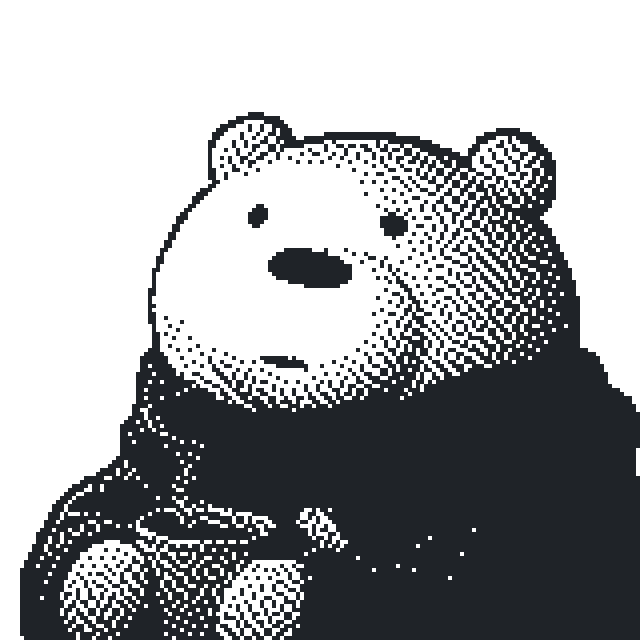

<!-- bear-picture -->
<picture>
  <source media="(prefers-color-scheme: dark)" srcset="bear/awake-dark.png">
  
</picture>
<!-- /bear-picture -->

Hi, I'm Qi Wu. I'm doing my master's in Darmstadt and building a little RISC-V CPU on the side. 

<!-- bear-status -->
Bear status: awake. Last push on 19 Nov.
<!-- /bear-status -->

Everything else is in my repos.

The bear went through <a href="hw/bear_dither.sv">bear_dither.sv</a>, a small Atkinson-dithering circuit, simulated in Verilator. Click it for the original.
